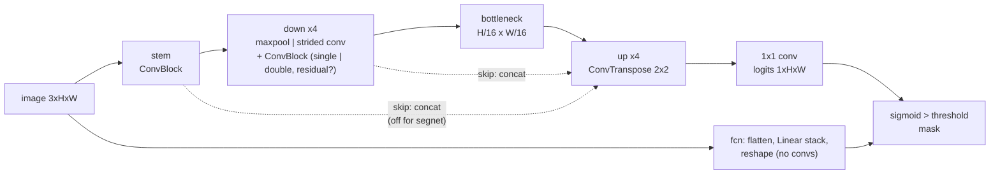
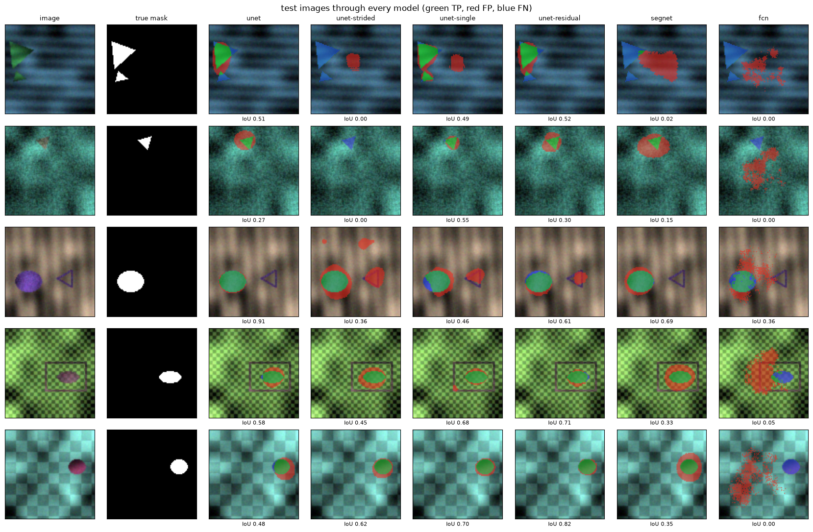
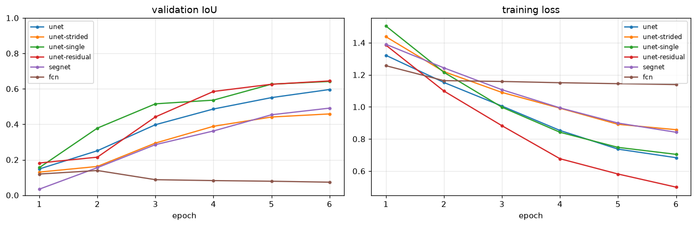
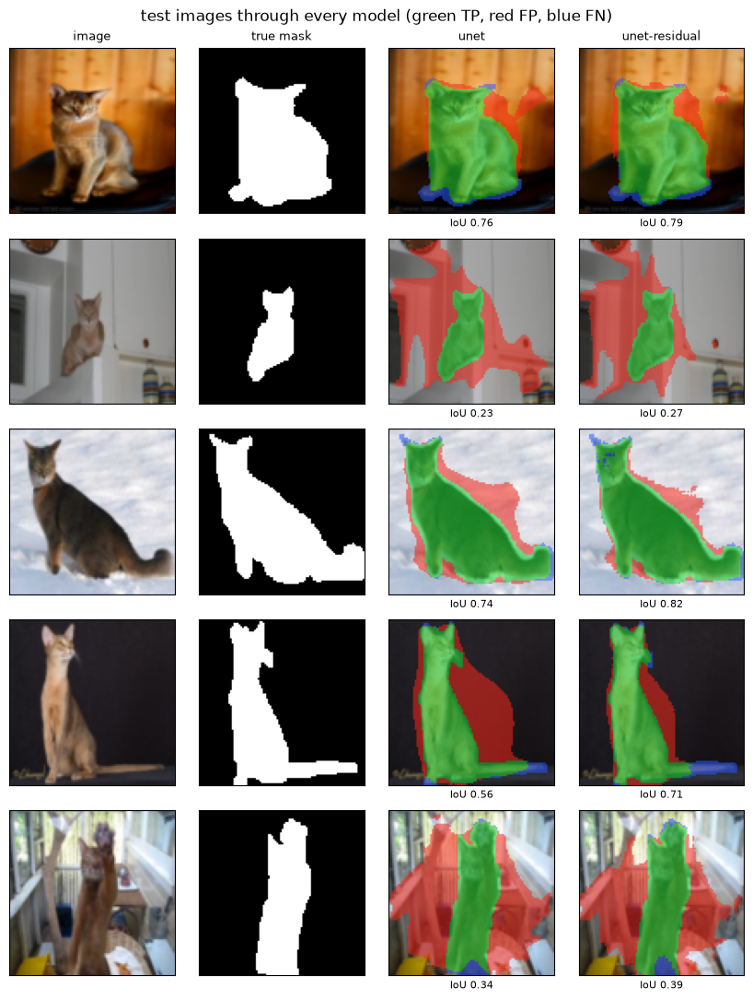

# unet-image-segmentation

**U-Net image segmentation in PyTorch, built to understand what each design choice buys:
skip connections, max-pool vs strided-conv down-sampling, one vs two convs per block,
residual blocks, a SegNet-like encoder-decoder without skips and a fully connected
baseline, each one a `--model` flag, all trained on the same data (synthetic shapes and
Oxford-IIIT Pet) and compared with IoU / Dice, a threshold sweep, tests and a
Kaggle/Colab notebook.**

[](LICENSE)
[](pyproject.toml)
[](https://pytorch.org)
[](docs/testing.md)

It grew out of a computer-vision coursework notebook (École Centrale) that asked four
questions about U-Net: does max-pooling beat strided convolution, how much do skip
connections bring, encoder-decoder vs a fully connected network, and how to pick the
inference threshold. Here each question is one flag, the models are small (1-2 M
parameters, a few minutes per run on a CPU), and the answers are re-measured with real
numbers.



| method | `--model` | how it works | code |
|---|---|---|---|
| U-Net | `unet` | 4 max-pool down steps, 2 convs per block, decoder concatenates the encoder map of the same size | `models.EncoderDecoder` |
| strided down-sampling | `unet-strided` | 3x3 conv with stride 2 (learned) instead of 2x2 max-pool (fixed) | `models.Down` |
| single conv | `unet-single` | one 3x3 conv per block instead of two (half the parameters) | `models.ConvBlock(double=False)` |
| residual blocks | `unet-residual` | each block computes relu(F(x) + x) (1x1 conv on x when channels change) | `models.ConvBlock(residual=True)` |
| SegNet-like | `segnet` | same encoder-decoder, **no skip connections**: the decoder only sees the bottleneck | `models.Up(skip=False)` |
| fully connected | `fcn` | flatten the image, Linear layers, reshape: no locality, no hierarchy | `models.FullyConnectedSeg` |
| any combination | `--skip/--no-skip --down maxpool\|strided --double/--no-double --residual` | the switches override the preset | `config.ModelConfig` |
| losses | `--loss bce\|dice\|bce+dice` | per-pixel BCE, soft Dice (overlap), or both (default) | `losses.SegLoss` |
| threshold sweep | `unetseg-eval` | IoU / Dice / precision / recall for thresholds 0.1 ... 0.9, chosen on val | `metrics.threshold_sweep` |

Every switch is explained with shapes, equations and the reason it exists in
[docs/architecture.md](docs/architecture.md), which also keeps the coursework's own
written conclusions.

## Quick start

```bash
git clone https://github.com/benisalla/unet-image-segmentation && cd unet-image-segmentation
uv venv .venv && VIRTUAL_ENV=.venv uv pip install -e ".[dev]"   # or: pip install -e ".[dev]"
source .venv/bin/activate

unetseg-data shapes                                     # 800/100/100 synthetic images, offline, 4 s
unetseg-train --model unet --epochs 6                   # ~4 min on one CPU core -> runs/unet/
unetseg-eval runs/unet/best.pt                          # metrics, threshold sweep, confusion, predictions
unetseg-predict runs/unet/best.pt data/shapes/test/images/test_00000.png --out predictions/
```

Swap `--model` for `unet-strided`, `unet-single`, `unet-residual`, `segnet` or `fcn`.
Real photos: `unetseg-data pets --max-images 1200` streams a random subset of Oxford-IIIT
Pet (~3 min, 41 MB on disk) with binary pet/background masks; then
`unetseg-train --data data/pets --size 96`. Optional albumentations augmentations:
`pip install -e ".[albumentations]"` and `--augment albumentations` (torchvision is the
default and needs nothing extra).

## Examples

[`examples/`](examples/README.md) holds six numbered scripts that use the package from
Python, each one command on a CPU: make and look at the data (with augmentations), train
a U-Net, sweep the threshold and draw the confusion matrix, predict on files with
overlays, print every variant's switches, parameters and per-stage tensor shapes, and
train `unet` vs `segnet` side by side to see what skip connections do.

```bash
python examples/01_make_data_and_look.py && python examples/02_train_unet.py
```

## Results

These are **short CPU runs** on a shared, loaded machine: 6 epochs, 600 training images,
96 px, one thread. Their purpose is to show that every variant learns and how the variants
compare on equal footing. They are not benchmarks. Commands, per-epoch numbers and the
threshold study are in [docs/evaluation.md](docs/evaluation.md).

### Synthetic shapes (object = 12% of the pixels, 100 test images)

| model | params | test IoU | test Dice | pixel acc | precision | recall | train time |
|---|---|---|---|---|---|---|---|
| `unet-single` | 0.96 M | **0.660** | **0.796** | 0.960 | 0.834 | 0.760 | 5.8 min |
| `unet-residual` | 2.03 M | 0.633 | 0.775 | 0.955 | 0.804 | 0.749 | 10.7 min |
| `unet` | 1.94 M | 0.560 | 0.718 | 0.943 | 0.728 | 0.708 | 7.6 min |
| `segnet` (no skips) | 1.75 M | 0.489 | 0.657 | 0.931 | 0.676 | 0.639 | 6.9 min |
| `unet-strided` | 2.14 M | 0.422 | 0.593 | 0.924 | 0.659 | 0.539 | 10.8 min |
| `fcn` (fully connected) | 19.21 M | 0.102 | 0.184 | 0.837 | 0.190 | 0.179 | 2.2 min |

What the comparison says about the coursework's questions:

- **Max-pool beats strided convolution.** IoU is 0.560 against 0.422, with fewer
  weights. The strided model also drops whole small objects.
- **Skip connections matter.** IoU is 0.560 against 0.489. Without them the masks become
  rounded blobs.
- **The fully connected model fails.** IoU is 0.10 with ten times the parameters. It
  learns where objects tend to be, not their shapes.
- **Pixel accuracy hides all of this.** Every model, including the fully connected one,
  scores above 0.83.

The single-conv and residual U-Nets lead the plain U-Net after 6 epochs because they
learn faster. That says nothing about final quality: the plain U-Net was still climbing
(0.49, 0.55, 0.60 over its last three epochs).





### Oxford-IIIT Pet subset (pet = 43% of the pixels, 120 test photos)

| model | params | test IoU | test Dice | pixel acc | precision | recall | train time |
|---|---|---|---|---|---|---|---|
| `unet-residual` | 2.03 M | **0.679** | **0.809** | 0.829 | 0.767 | 0.855 | 8.1 min |
| `unet` | 1.94 M | 0.641 | 0.781 | 0.800 | 0.727 | 0.844 | 6.6 min |

With 600 photos and 6 epochs both models find the animal (recall about 0.85). They also
paint background of similar colour, so precision is lower. The residual blocks give
+0.04 IoU at the same size. The full dataset at 160 px is the notebook's job.



The **threshold** barely matters once the loss is BCE + Dice. The best validation
threshold was between 0.45 and 0.55 for every convolutional model, and it changed test
IoU by less than 0.01 ([curves](assets/shapes_unet_thresholds.png)). The fully connected
model is the exception: its probabilities are all lukewarm, so its best threshold is 0.20.

## Train for real: Kaggle / Colab notebook

[`notebooks/train_colab_kaggle.ipynb`](notebooks/train_colab_kaggle.ipynb) (generated by
`notebooks/build_notebook.py`) installs this repo with pip and imports `unetseg`. It
explains U-Net step by step in markdown between the code cells (encoder and decoder,
skip connections, max-pool vs strided conv, double conv, residual blocks, the fully
connected baseline, BCE vs Dice, thresholds), then trains a wider U-Net (`base 32`) on
all 7 390 Pet photos at 160 px on a GPU with live curves, compares every variant, sweeps
the threshold and draws predictions. `SMOKE_TEST = True` runs it end to end on a CPU in
a few minutes.

## Repository layout

```
src/unetseg/
  config.py     ModelConfig / TrainConfig, the six presets
  models.py     ConvBlock, Down, Up, EncoderDecoder (U-Net / SegNet-like), FullyConnectedSeg
  losses.py     BCE, soft Dice, BCE + Dice
  metrics.py    confusion matrix -> IoU, Dice, pixel acc, precision, recall, F1; threshold sweep
  data.py       folder dataset (in memory), joint augmentations (torchvision / albumentations)
  datasets.py   shapes generator and Oxford-IIIT Pet subset, `unetseg-data`
  train.py      training loop, checkpoints, live curves, `unetseg-train`
  evaluate.py   test metrics, threshold sweep, figures, `unetseg-eval`
  predict.py    masks and overlays for image files, `unetseg-predict`
  viz.py        curves, prediction grids, TP/FP/FN overlays, threshold and confusion plots
scripts/compare_all.py   train several variants on the same data -> table + comparison figures
tests/          28 tests, ~30 s on one CPU core
examples/       six numbered scripts
docs/           architecture, data, training, evaluation, testing
notebooks/      build_notebook.py -> train_colab_kaggle.ipynb
legacy/         the original coursework notebook + what was fixed
assets/         the figures below
```

## Documentation

- [docs/architecture.md](docs/architecture.md): every variant, shapes, equations, why; the coursework's conclusions
- [docs/data.md](docs/data.md): folder layout, the shapes generator, the Pets subset, augmentation
- [docs/training.md](docs/training.md): the loop, optimiser and schedule, update ratio, speed
- [docs/evaluation.md](docs/evaluation.md): metrics, threshold choice, the runs behind the results
- [docs/testing.md](docs/testing.md): what the tests check
- [examples/](examples/README.md): the package from Python, step by step

## Legacy notebooks

[`legacy/Image_Segmentation.ipynb`](legacy/Image_Segmentation.ipynb) is the original
coursework notebook, unchanged. [legacy/README.md](legacy/README.md) lists what it did
and the problems found while porting it (validation and test sets that were augmented,
a threshold sweep over 40 ... 80 instead of 0.40 ... 0.80, a fully connected model whose
last ReLU forbade negative logits, a skip-connection flag named `is_resnet`, the last
epoch tested instead of the best one, model selection on pixel accuracy) and how the
package fixes each.

## References

Ronneberger, Fischer, Brox 2015 (U-Net) · Badrinarayanan, Kendall, Cipolla 2017 (SegNet) ·
Long, Shelhamer, Darrell 2015 (Fully Convolutional Networks) · He et al. 2016 (ResNet) ·
Milletari, Navab, Ahmadi 2016 (V-Net, Dice loss) · Parkhi, Vedaldi, Zisserman, Jawahar 2012
(Oxford-IIIT Pet).

## License

MIT, (c) 2026 Ismail Ben Alla
